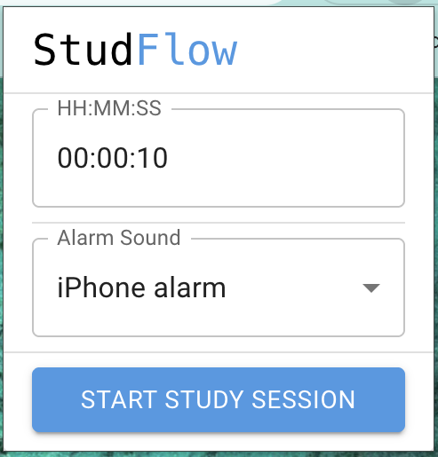
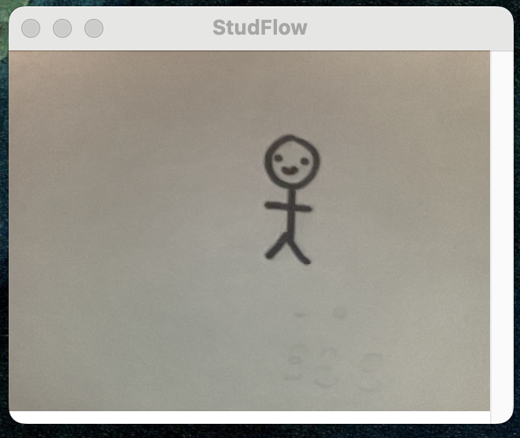
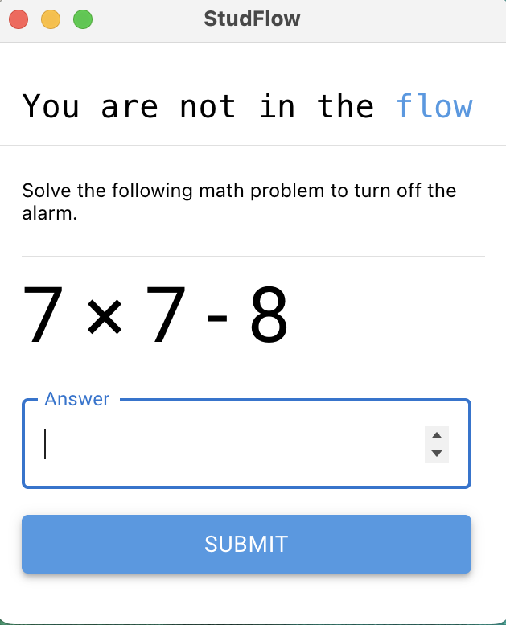

# StudFlow
Distractions detering you from getting into the flow for studying? Install StudFlow to ensure you're back in the flow of studying. Through camera vision and mediapipe models, StudFlow ensures that you are at your desk, awake, and drilling through your tasks. The chrome extension offers features to personalize your experience, through your own customized timer threshold and alarm preferences. If you are not present or getting too much shut-eye, be prepared for a loud awakening that will not stop until you get your brain back to work and complete a simple arithmic exercise.

Enough rambling, let your studies take the flow.

## Features
Choose your make break time and alarm preferences.

Keep the window in the background while you study.

Solve a simple problem to keep the alarm down.
